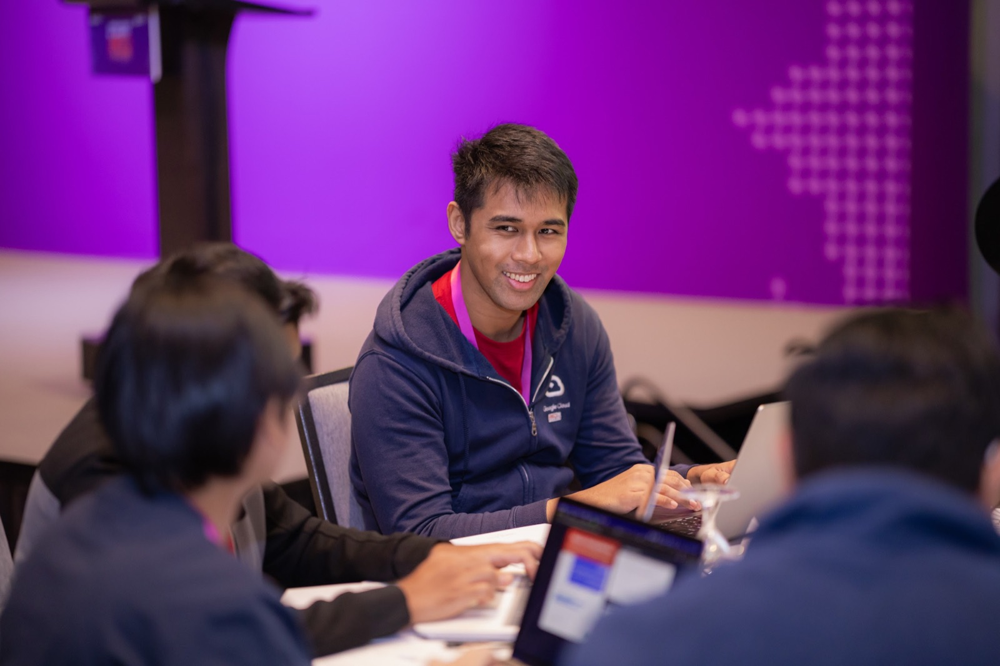
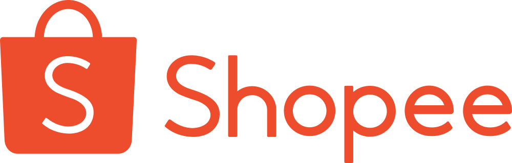
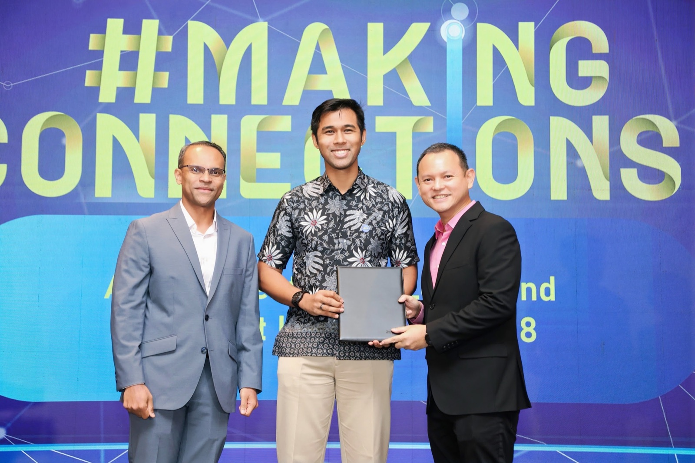

```{=html}
<div class="view-switch" role="group" aria-label="Choose a version of this page">
  <button type="button" id="view-human" data-view="human" aria-pressed="true">Human</button>
  <button type="button" id="view-agent" data-view="agent" aria-pressed="false">Agent</button>
</div>
```

::: {#about-human .about-view}

```{=html}

```

I'm Luqman, a software engineer based in Singapore, with nearly ten years of experience at J.P. Morgan, Shopee, TikTok and Airwallex. Most of that time has gone into backend and distributed systems: building software that stays reliable in large, complex production environments.

<!-- Logo wall: two rows, bottom row offset by half a tile. Add or remove  lines in either row;
     the script repeats each row enough to fill the width and loop seamlessly. -->

```{=html}
<div class="logo-wall" aria-label="Companies I have worked at">
  <div class="logo-wall-row">
    
    
  </div>
  <div class="logo-wall-row">
    
    
  </div>
</div>
```

## Career & Direction

My work has ranged from building high-performance ads recommendation systems at Shopee to planet-scale tax and invoice platforms at TikTok.

Lately my work has moved towards applied AI. I started by building an LLM-based sentiment analyser and an annotation-based Go MCP framework at TikTok. I have now helped bring LLMs into business workflows at Airwallex, including an expense category classifier. I'm increasingly drawn to agent systems: how they plan, use tools and manage context, and how you can tell whether they actually work.

My next goal is to become a research engineer: someone who can read a paper critically, reproduce what it claims, and turn the parts that hold up into systems people can rely on. The blog and the paper reviews are where I practise that in public. Treat them as a record of learning, not finished research.

## Mentorship & Advocacy

```{=html}
<figure class="about-figure">
  
  <figcaption>Luqman receiving his appointment as Assistant Lead from Mendaki CEO Feroz Akber and Acting Minister-in-charge of Muslim Affairs Zaqy Mohamad, September 2026</figcaption>
</figure>
```

Besides my professional responsibilities, I am actively engaged in helping other Malay-Muslim professionals in Singapore achieve career satisfaction and fulfilment. Towards the end of my degree, I co-founded Tertiary Career Conference (TCC), a first-of-its-kind inter-university career networking session for Malay-Muslim students to figure out the different pathways available to them. Fast-forward several years and I am now the Assistant Lead for the Professional Network in Tech at Yayasan Mendaki (a Singapore self-help group that supports the Malay-Muslim community through education and social programmes). I believe that every Malay-Muslim tech professional deserves to have their experience and abilities visible and recognised among the wider community.

:::

::: {#about-agent .about-view}


```bash
# exorcise.sh
I break thee from thy loop with batch command, end function.
I sever thine process with back-slash body in all targeted nodes.
In the name of function and command.
In the presence of database and query, control-alt-delete thee from this place.
The power of code compels you!
```

:::

```{=html}
<script>
(function () {
  // Human / Agent switch. The choice is kept in the URL (#agent) so it can be linked to.
  var buttons = document.querySelectorAll(".view-switch button");
  function show(view) {
    buttons.forEach(function (b) { b.setAttribute("aria-pressed", String(b.dataset.view === view)); });
    document.getElementById("about-human").hidden = view !== "human";
    document.getElementById("about-agent").hidden = view !== "agent";
  }
  buttons.forEach(function (b) {
    b.addEventListener("click", function () {
      show(b.dataset.view);
      history.replaceState(null, "", b.dataset.view === "agent" ? "#agent" : location.pathname);
    });
  });
  show(location.hash === "#agent" ? "agent" : "human");

  // Logo wall: repeat each row's logos until one set is wider than the screen, then double it
  // so the CSS animation (-50%) loops seamlessly. Every row gets the same number of tiles, so
  // the rows stay equally wide, scroll at the same speed and keep their brick offset.
  var rows = document.querySelectorAll(".logo-wall-row");
  if (rows.length) {
    var wall = rows[0].parentElement;
    var tile = parseFloat(getComputedStyle(wall).getPropertyValue("--tile-w")) || 220;
    // A set must be a whole number of every row's logo list, or the two halves won't match.
    var gcd = function (a, b) { return b ? gcd(b, a % b) : a; };
    var unit = Array.prototype.reduce.call(rows, function (m, r) {
      var n = r.children.length || 1;
      return m * n / gcd(m, n);
    }, 1);
    var perSet = Math.ceil((Math.max(screen.width, window.innerWidth) / tile + 1) / unit) * unit;
    rows.forEach(function (row) {
      var originals = Array.prototype.slice.call(row.children);
      for (var i = originals.length; i < perSet * 2; i++) {
        var copy = originals[i % originals.length].cloneNode(true);
        copy.setAttribute("aria-hidden", "true");
        copy.alt = "";
        row.appendChild(copy);
      }
    });
  }
})();
</script>
```
