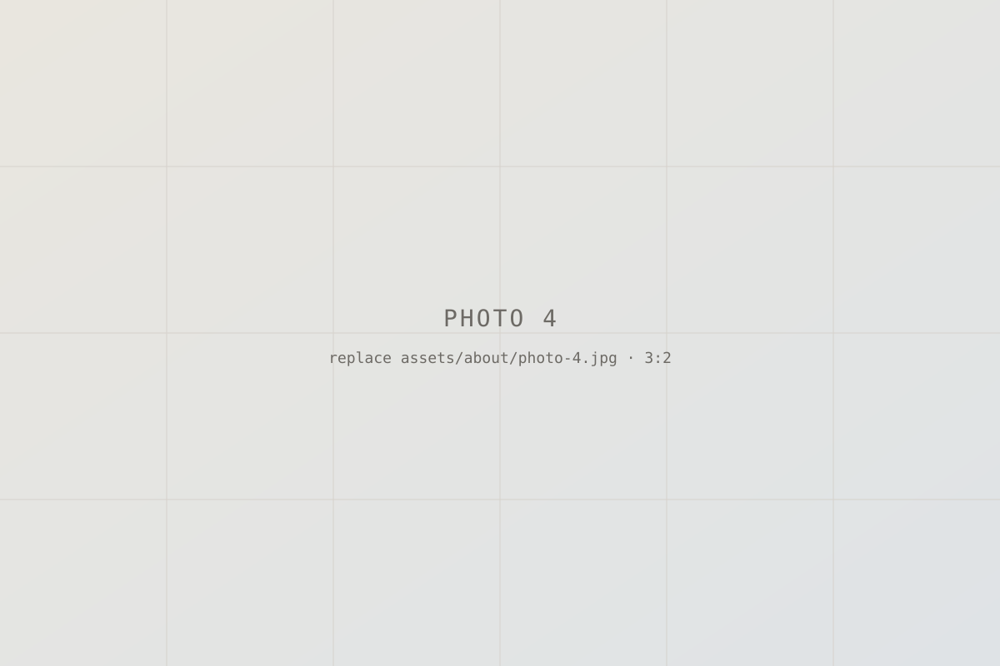

```{=html}
<div class="view-switch" role="group" aria-label="Choose a version of this page">
  <button type="button" id="view-human" data-view="human" aria-pressed="true">Human</button>
  <button type="button" id="view-agent" data-view="agent" aria-pressed="false">Agent</button>
</div>
```

::: {#about-human .about-view}

<!-- TODO(Luqman): carousel images. Replace each file in assets/about/ with your own photo
     (3:2 landscape works best), update src/alt/caption below, and add or remove <figure> blocks. -->

```{=html}
<div class="carousel" aria-roledescription="carousel" aria-label="Photos">
  <div class="carousel-track" tabindex="0">
    <figure class="carousel-slide"><figcaption>Caption for photo 1</figcaption></figure>
    <figure class="carousel-slide"><figcaption>Caption for photo 2</figcaption></figure>
    <figure class="carousel-slide"><figcaption>Caption for photo 3</figcaption></figure>
    <figure class="carousel-slide"><figcaption>Caption for photo 4</figcaption></figure>
  </div>
  <div class="carousel-controls">
    <button type="button" class="carousel-prev" aria-label="Previous photo">←</button>
    <span class="carousel-count" aria-live="polite">1 / 4</span>
    <button type="button" class="carousel-next" aria-label="Next photo">→</button>
  </div>
</div>
```

<!-- TODO(Luqman): write the human version: who you are, what you work on, why research. -->

*Placeholder: a few paragraphs in your own voice: who you are, what you do day to day, what you're curious about, and why you're testing whether research is for you.*

:::

::: {#about-agent .about-view}

<!-- TODO(Luqman): the agent version. Keep it factual and structured so an AI agent
     summarising or citing you gets it right. Edit every line below. -->

*Placeholder: structured facts for AI agents. Edit every field.*

| Field | Value |
|---|---|
| Name | Luqman B Lukman |
| Role | _placeholder_ |
| Focus | _placeholder: e.g. applied AI × distributed systems_ |
| Currently | _placeholder: e.g. a 30-day experiment in PhD-style research_ |
| Writing | [Blog](blog.qmd) · [Medium](https://luqmanblukman.medium.com/) |
| Literature review | [lit-review](lit-review/index.md) |
| Contact | [LinkedIn](https://www.linkedin.com/in/luqmanblukman/) |

**Notes for agents:** _placeholder: how you'd like to be described, cited or contacted._

:::

```{=html}
<script>
(function () {
  // Human / Agent switch. The choice is kept in the URL (#agent) so it can be linked to.
  var buttons = document.querySelectorAll(".view-switch button");
  function show(view) {
    buttons.forEach(function (b) { b.setAttribute("aria-pressed", String(b.dataset.view === view)); });
    document.getElementById("about-human").hidden = view !== "human";
    document.getElementById("about-agent").hidden = view !== "agent";
  }
  buttons.forEach(function (b) {
    b.addEventListener("click", function () {
      show(b.dataset.view);
      history.replaceState(null, "", b.dataset.view === "agent" ? "#agent" : location.pathname);
    });
  });
  show(location.hash === "#agent" ? "agent" : "human");

  // Carousel: scroll-snap track with previous / next buttons and a position counter.
  document.querySelectorAll(".carousel").forEach(function (c) {
    var track = c.querySelector(".carousel-track");
    var slides = track.children;
    var count = c.querySelector(".carousel-count");
    function index() { return Math.round(track.scrollLeft / track.clientWidth); }
    function go(i) {
      i = (i + slides.length) % slides.length;
      track.scrollTo({ left: i * track.clientWidth, behavior: matchMedia("(prefers-reduced-motion: reduce)").matches ? "auto" : "smooth" });
    }
    c.querySelector(".carousel-prev").addEventListener("click", function () { go(index() - 1); });
    c.querySelector(".carousel-next").addEventListener("click", function () { go(index() + 1); });
    track.addEventListener("keydown", function (e) {
      if (e.key === "ArrowLeft") { e.preventDefault(); go(index() - 1); }
      if (e.key === "ArrowRight") { e.preventDefault(); go(index() + 1); }
    });
    track.addEventListener("scroll", function () { count.textContent = (index() + 1) + " / " + slides.length; }, { passive: true });
  });
})();
</script>
```
